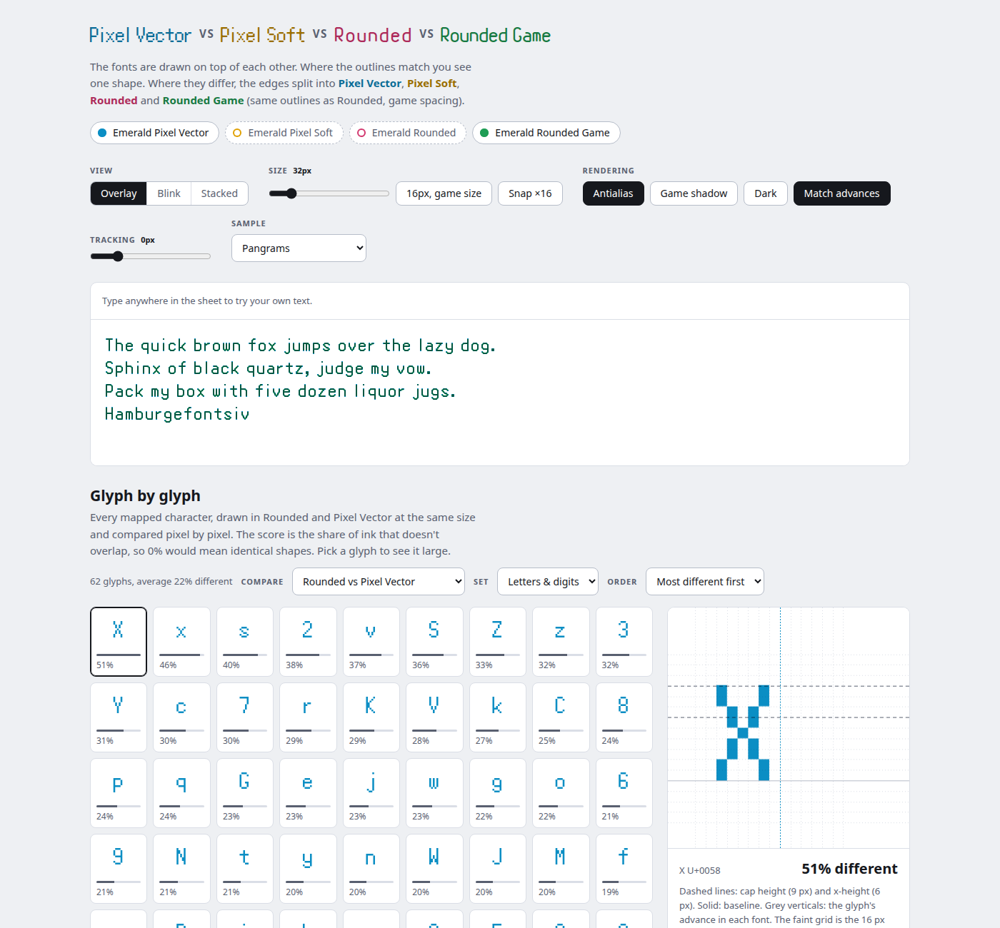
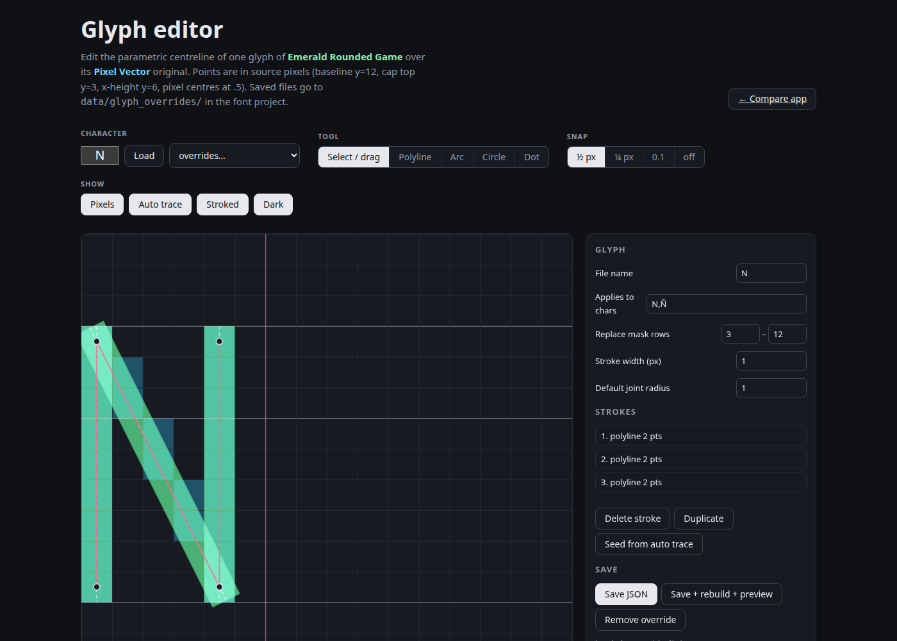

# Font Compare

A local, no-build web app for comparing fonts glyph by glyph, plus a parametric glyph editor. It was
written to tune [Emerald Rounded](https://github.com/pizzacatz/pokemon-custom-emerald-font), the
smooth remake of Pokémon Emerald's dialogue font, against the original pixel font, and it ships with
those four fonts in `fonts/`.



## Run

```sh
./serve.sh          # http://localhost:8768 (steps to the next free port if taken)
./sync-fonts.sh     # re-copy TTFs from ../pokemon-custom-emerald-font and refresh metrics.json
```

Python 3 is the only requirement. The editor's save and rebuild buttons expect the font project
checked out beside this folder as `../pokemon-custom-emerald-font`, with its toolchain set up as
described in its README; the comparison sheet works without it.

## The comparison sheet (`/`)

- **Overlay**: all enabled fonts drawn on top of each other with multiply blending (screen in dark
  mode). Matching outlines read as one dark shape; differences split into the layer colours. The sheet
  is an editable text area, so type anything.
- **Blink**: cycles through the enabled fonts; pause or step with Next.
- **Stacked**: every line in each enabled font, baseline-aligned.
- Size slider (8 to 160 px), *16px, game size*, *Snap ×16* for pixel-exact rendering of the pixel
  font, antialiasing toggle, game-style drop shadow, dark theme, tracking slider, and *Match advances*
  which gives the pixel fonts the tracked font's spacing so glyphs line up.
- **Glyph by glyph**: each character rendered in two fonts on a canvas and scored by non-overlapping
  ink. Sort by difference or code point; choose letters and digits, all mapped characters, or the
  game-only PUA symbols. Click a glyph for a loupe with baseline, x-height, cap height, advance
  widths and the 16 px pixel grid.
- **Metrics** table read from the TTFs by `gen_metrics.py`.
- Sample text groups live in `samples.json`. Your own text is kept in localStorage.

## The glyph editor (`/editor.html`)



Draws a glyph on the source pixel grid with the original bitmap behind it and lets you define it
mathematically: polylines with per-joint radii, circular arcs by bulge or by centre and angles,
circles, dots (round, square, rounded square), join styles, cut masks and row/column clips. Every
number is editable in the side panel, and the stroked result is previewed live and overlaid on the
pixel original.

- Open any glyph by typing it, by code point (`U+E053`), or from the "All glyphs" picker that lists
  the game symbols too.
- *Seed from auto trace* starts from the generated model; *Save* writes
  `data/glyph_overrides/<name>.json` in the font project; *Rebuild* regenerates the font and reloads
  it in the sheet. Errors in an override are reported in the log with the glyph name.
- The JSON format is documented in the font project's README.

## Adapting it to other fonts

`app.js` has a `KEYS` table naming the fonts and their colours, `style.css` declares the `@font-face`
rules, and `gen_metrics.py` reads any TTF. Drop your own fonts in `fonts/` and edit those three
places. The editor is specific to the Emerald project's pixel-grid model.

## Licence

[The Unlicense](LICENSE): public domain. The bundled fonts are a fan conversion of Pokémon Emerald's
pixel font; see the font project's licence note.
